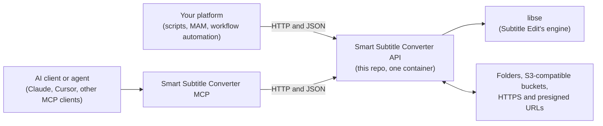

# Smart Subtitle Converter API

[](https://github.com/Wauter/smart-subtitle-converter-api/actions/workflows/ci.yml)
[](LICENSE)

**An HTTP API for converting and checking subtitles, built on Subtitle Edit's conversion engine.**

It handles SRT, WebVTT, TTML, ASS and broadcast formats such as EBU STL, PAC and Cavena 890, and runs as a single
container. Each conversion reports whether anything was lost and which setting fixes it, so it can run unattended
in a media workflow or be handed to an AI agent.

> **Built on Subtitle Edit.** All format reading and writing is done by `libse`, the library behind
> [Subtitle Edit](https://github.com/SubtitleEdit/subtitleedit) by **Nikolaj Olsson** (MIT). This is a community
> project, **not an official Subtitle Edit project**.
>
> **Early software.** Expect changes, and please
> [report issues](https://github.com/Wauter/smart-subtitle-converter-api/issues).

## What it adds to the engine

`libse` already reads and writes the formats. This project adds what you need before a conversion can run without
someone checking the result by hand.

- **Verified output.** Every binary broadcast output (EBU STL, PAC, FPC, Cavena 890, CapMaker Plus, Cheetah CAP)
  is read back and reported as `lossless`, `quantised`, `lossy` or `unverified`. The report names cue numbers and
  code points, never subtitle text.
- **No guessing.** A file that could be read more than one way (PAC or FPC, or an unclear text encoding) is
  refused with the candidates listed.
- **Warnings with a fix.** When characters would be lost, the warning names the setting to change. For PAC, the
  API tests each code page and lists only the ones that keep every character. It never switches settings on its
  own.
- **Source checks.** Overlapping cues, cues longer than 30 seconds, zero-length cues, header fields filled with
  defaults such as `No Title`, and the frame rate used for frame-based formats.
- **Storage and jobs.** Reads and writes allowlisted folders, S3-compatible buckets and HTTPS or presigned URLs.
  Every conversion gets a job id.
- **AI agents.** The companion [MCP server](https://github.com/Wauter/smart-subtitle-converter-mcp) exposes the
  same conversions and checks to Claude, Cursor and other MCP clients.

Every error and warning has a stable code, an explanation and a suggested fix ([docs/errors.md](docs/errors.md)).

### What a verdict looks like

Greek SRT written as PAC with the default Latin code page (code points shortened):

```json
{
  "verdict": "lossy",
  "cuesWritten": 3, "cuesReadBack": 3,
  "timing": { "maxShiftMs": 13, "meanShiftMs": 4.3, "frameMs": 41.7, "cuesOverOneFrame": 0 },
  "replacedChars": { "total": 50, "cueCount": 3, "cues": [1, 2, 3], "distinctCodePoints": 27,
                     "codePoints": [{ "codePoint": "U+03B1", "count": 5 }, { "codePoint": "U+03B9", "count": 4 }] }
}
```

The warning names the fix:

```json
"hint": "Lost characters are Greek (U+03B1, U+03B9, U+03B5, U+03BC, U+03BF, …) (detected source language: el); set formatOptions.pac.codePage to \"greek\" (the only value that keeps every character of this text, tested; current: latin) or use target fpc (Unicode PAC). Never switched automatically."
```

With `formatOptions.pac.codePage: "greek"` the same input is `"verdict": "quantised"`. Field reference:
[verification](docs/errors.md#verification-binary-outputs) and [remedy](docs/errors.md#remedy-characters-replaced).

## Two ways to use it



- **From an AI client or coding agent:** start the API with the quick start below, then add the
  [Smart Subtitle Converter MCP](https://github.com/Wauter/smart-subtitle-converter-mcp).
- **From your own platform:** call the HTTP API. There is a JSON endpoint, an OpenAPI contract and a JSON Schema
  for profiles.

## Quick start

With Docker. The API needs a key, so first create an empty key file it can write (the container runs as UID 1654):

```bash
touch api_keys.txt && chmod 600 api_keys.txt && sudo chown 1654 api_keys.txt
docker run -d --name smart-subtitle-converter -p 127.0.0.1:8080:8080 \
  -v "$PWD/api_keys.txt:/api_keys.txt" ghcr.io/wauter/smart-subtitle-converter-api:latest
curl localhost:8080/healthz   # {"status":"ok","version":"…","libse":"…"}
```

On first start the API writes a new key into `api_keys.txt` (it never prints it). Then convert something:

```bash
KEY=$(sudo grep -v '^#' api_keys.txt | head -1)
curl -H "Authorization: Bearer $KEY" -F file=@movie.srt -F target=webvtt localhost:8080/v1/convert -OJ   # saves movie.vtt
```

Open <http://localhost:8080/docs> for the interactive API reference.

- More on keys, host names and the MCP setup: [Securing the API](docs/security.md#securing-the-api).
- Other ways to run it (Docker Compose, building from source, image tags): [docs/deployment.md](docs/deployment.md).

## More examples

These use the `$KEY` variable from the quick start.

```bash
# a built-in preset, with overrides
curl -H "Authorization: Bearer $KEY" -F file=@movie.srt -F preset=netflix-en-vtt \
     -F 'profile={"rules":{"maxLineLength":37}}' localhost:8080/v1/convert -OJ

# SRT -> EBU STL at 25 fps
curl -H "Authorization: Bearer $KEY" -F file=@movie.srt -F target=ebustl \
     -F 'profile={"formatOptions":{"ebuStl":{"frameRate":25}}}' localhost:8080/v1/convert -OJ

# what is this file?
curl -H "Authorization: Bearer $KEY" -F file=@mystery.txt localhost:8080/v1/detect
```

Errors are `application/problem+json` with a stable `code` and a `hint`:

```json
{ "status": 400, "code": "invalid-profile",
  "detail": "The profile has 1 error(s); first at '/target/format': Unknown format 'vtt2'.",
  "hint": "Did you mean 'webvtt'? See GET /v1/formats." }
```

Every endpoint with curl examples: [docs/usage.md](docs/usage.md). A Postman collection that covers every
endpoint is in [`postman/`](postman) ([how to use it](docs/development.md#postman--newman)).

## Supported subtitle formats

| | Formats |
|---|---|
| **Text, read and write** | SRT, WebVTT, ASS/SSA, TTML/DFXP, SBV, SMI and Subtitle Edit's other text formats |
| **Editing and post-production** | Final Cut Pro XML captions (`.fcpxml`), and marker lists from Avid and EDIUS |
| **Binary broadcast, read and write** | EBU STL, PAC, FPC, Cavena 890, CapMaker Plus, Cheetah CAP |
| **Binary, read only** | Avid STL, Ayato, Spruce STL and others |
| **Not supported** | Image-based and container formats (Blu-ray sup, VobSub, Matroska, MP4) |

`GET /v1/formats` has the live list for your version; Subtitle Edit's
[supported formats](https://subtitleedit.github.io/subtitleedit/reference/supported-formats.html) page describes
the formats themselves. In addition, `/v1/detect` names a file's format, encoding, code page and, for
frame-based files, the frame rate used. Code pages, frame rates and detection rules:
[docs/formats.md](docs/formats.md).

## Presets and profiles

A profile is a JSON document that describes a conversion: formats, rules, timing, format options and Subtitle
Edit operations such as Fix Common Errors. Built-in presets cover common broadcast and streaming cases
(`netflix-en-vtt`, `pal-to-film`, `clean-srt`, …), and your own JSON presets in a mounted folder are picked up
without a restart. See [docs/profiles.md](docs/profiles.md).

## Storage and job tracking

- **Storage.** Send one subtitle per request: as an upload or inline content, or as an `input` location on an
  allowlisted folder, an S3-compatible bucket (AWS, MinIO and similar) or an HTTPS or presigned URL. An
  optional `output` location stores the result.
- **Sidecar.** `sidecar: true` writes `{output}.json` with the verification and warnings next to the output (a
  write without it removes an old sidecar).
- **No silent overwrites.** Filesystem and S3 outputs are never overwritten unless you send `ifExists: "replace"`.
- **Jobs.** Every conversion returns a job id. Long requests continue in the background with `202` and a URL to
  poll, and the stored input and output can be re-read through the job while its record lives.
- **Browsing.** You can list the allowed file and S3 folders and read a file by its location (on by default,
  limited to the allowlists; `STORAGE_LIST_ENABLED=false` turns it off).

Start with [usage](docs/usage.md#job-metadata), [configuration](docs/configuration.md#jobs-and-storage),
[limits](docs/limits.md), [mounted storage](docs/deployment.md#mounted-subtitle-storage),
[allowlists and network checks](docs/security.md) and [`.env.example`](.env.example).

## Safeguards

The defaults are meant for one machine or an internal network.

- **Authentication is on by default.** A key is generated on first start and is never printed or logged. Rate
  limits are optional.
- **It answers only to host names you list**, and refuses requests that come from other web pages.
- **Access is limited to the folders, buckets and hosts you allow.** Hidden files and folders are blocked,
  symlinks are never followed, and only subtitle file types are touched.
- **The container is minimal.** A chiseled ASP.NET Core base with no shell, running as a non-root user, for amd64
  and arm64. The reference Compose file adds a read-only root filesystem, dropped capabilities and a
  `127.0.0.1`-only port.

It has not been independently audited, and it is meant for a trusted environment, not the public internet.
Details and how to change the defaults: [docs/security.md](docs/security.md).

## Good to know

- **One job at a time.** `libse` uses global settings, so one worker runs one job at a time from a bounded queue.
  Settings are reset after every job, and a full queue answers `503` with `Retry-After`.
- **Job history is not a file archive.** It is kept in memory only, holds metadata (never file bytes), expires,
  and is cleared on restart.
- **One subtitle per request.** ZIP and batch conversion are not supported.
- **A verdict is a read-back, not a playout test.** It proves the file is self-consistent through `libse`'s own
  reader; it does not prove that the target playout or editing software accepts it.
- **Tested.** An automated test suite covers the formats, the error handling and the storage backends, and
  problems found along the way became regression tests ([docs/development.md](docs/development.md)).

## Documentation

| Read this | When you want to |
|---|---|
| [docs/usage.md](docs/usage.md) | See every endpoint with curl examples, the JSON endpoint, storage locations, jobs and response headers |
| [docs/formats.md](docs/formats.md) | Work with binary formats: detection, code pages, frame rates, verification |
| [docs/profiles.md](docs/profiles.md) | Use presets, write your own profiles, chain operations |
| [docs/configuration.md](docs/configuration.md) | Change ports, limits, storage allowlists, job history, metrics or health checks |
| [docs/security.md](docs/security.md) | Secure the API: API keys, host names, exposing it beyond localhost, how files are handled |
| [docs/deployment.md](docs/deployment.md) | Pick an image tag, run without Compose, build from source |
| [docs/errors.md](docs/errors.md) | Look up an error or warning code: what happened, why, what to do; verification and remedy fields |
| [docs/development.md](docs/development.md) | Build, test, run Postman/newman, see what CI does |
| [docs/design.md](docs/design.md) · [docs/roadmap.md](docs/roadmap.md) | Understand the design decisions and what comes next |
| [CHANGELOG.md](CHANGELOG.md) · [CONTRIBUTING.md](CONTRIBUTING.md) | See what changed, and the versioning rule |
| [docs/openapi.v1.json](docs/openapi.v1.json) | Generate a client (also served live at `/openapi/v1.json`) |

Using it from an AI agent? Install the
[Smart Subtitle Converter MCP](https://github.com/Wauter/smart-subtitle-converter-mcp) release whose major.minor
version matches this API's.

## Feedback and author

Bug reports are welcome, especially with a file that converts wrongly:
[open an issue](https://github.com/Wauter/smart-subtitle-converter-api/issues).

Built by [Wauter De Bruyne](https://www.linkedin.com/in/wauterdebruyne/), a solution architect working on media
workflow automation for broadcasters, sports organisations and streaming platforms.

## Credits and license

All subtitle format support comes from [Subtitle Edit](https://github.com/SubtitleEdit/subtitleedit) and its
`libse` library by Nikolaj Olsson and contributors, used under the MIT license.

This project is MIT licensed, see [LICENSE](LICENSE).
